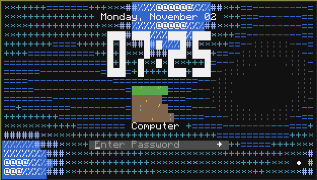
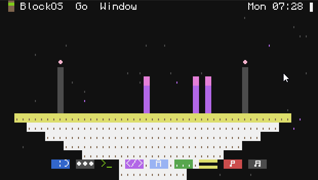
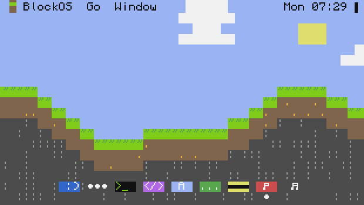
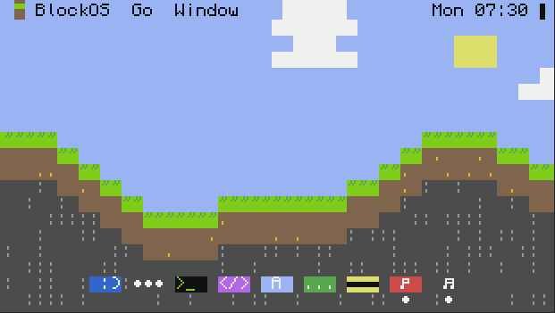

# BlockOS


A macOS-inspired desktop operating system for **Advanced Computers** in
[CC: Tweaked](https://tweaked.cc). BlockOS gives you a menu bar, a dock, movable
windows with traffic-light buttons and full-screen mode, a Launchpad, a login
screen, and a set of bundled apps.

## Install

On an **Advanced Computer** (or Advanced Turtle), run:

```
wget run https://raw.githubusercontent.com/tamayaren/BlockOS/main/install.lua
```

The installer opens an onboarding wizard: name the computer, create your
account, pick light or dark mode, an accent colour and a wallpaper, choose your
update settings, and BlockOS installs itself. Your old `startup.lua` is kept as
`startup.lua.bak`.

Running the installer again on a computer that already has BlockOS updates the
system files and keeps your data.

On a **turtle**, the installer offers the *Turtle Agent* instead: a small
program that lets the Turtles app on a BlockOS computer pair with and drive the
turtle over rednet (basic turtles get the agent automatically).

> HTTP must be enabled on the server (it is by default) for installing,
> updates, the App Store, Pastebin installs and bTunes.

## The desktop



| Area | What it does |
| --- | --- |
| Menu bar | Block logo menu (About, Settings, App Store, Force Quit, Lock, Log Out, Restart, Shut Down), the app's name, **Go** and **Window** menus, an update arrow when one is available, the **Control Center** icon, the clock, and a Show Desktop sliver in the top-right corner that hides every window (click it again to bring them back). Solid, clear (the wallpaper shows through) or blur (the wallpaper's colours smoothed into soft blocks) in **Settings → Appearance**. |
| Dock | Pinned apps, running apps (dot underneath) and a Messages unread badge. Right-click an icon to open, quit, keep it in the dock or add it to the desktop. Small (2 rows, the default) or large, solid or clear (no background, just the icons and running dots) in **Settings → Dock**. |
| Windows | Drag the title bar to move, drag the bottom-right corner to resize. Red closes, yellow minimizes, green goes full screen. |
| Full screen | Hides the dock and menu bar like macOS. Click the top-left corner, right-click or scroll up on the top row, or press Ctrl+Shift+Up to show the menu bar and the window buttons (close, minimize, exit full screen). |
| Launchpad | Every app in a searchable grid. Type to search, scroll for more pages. Right-click an app to open it full screen, keep it in the dock or add it to the desktop. |
| Desktop | Right-click for New Terminal, Finder, Change Wallpaper, Settings. Shortcuts to apps, files and folders line up down the left: click to select, double-click to open, right-click to open, edit, show in Finder, remove the shortcut or delete the file. |
| Lock screen | Date and a large clock over an animated screensaver, your name and a password field. The button in the bottom-right corner restarts or shuts down. Pick the screensaver colours in **Settings → Lock Screen** (your accent colour by default). |

### Control Center

Click the icon left of the clock in the menu bar (or press Ctrl+Shift+C) to drop down the
Control Center:

| Control | What it does |
| --- | --- |
| WiFi | Turns every wireless and ender modem off or back on. Same switch as **Settings → WiFi**. |
| Do Not Disturb | Stops notification banners and sounds. Notifications still arrive and wait in the Control Center; a `z` shows next to the icon while it is on. Also in **Settings → Notifications**. |
| Dark Mode | Switches between light and dark appearance. |
| Lock Screen | Locks the computer. |
| Sound | The system volume. Click or drag along the bar, or scroll over it. It scales bTunes and notification sounds. |
| Now Playing | Shows while bTunes is playing or paused: the track, time, and previous, play/pause and next buttons. |
| Notifications | Recent notifications, newest first. Click one to open its app, **x** to dismiss it, **Clear** to dismiss them all. Scroll for more. |

**Settings → WiFi** lists every attached modem with its own switch. A modem that is off is closed
and stays closed: nothing can open it or transmit on it (rednet, GPS or a wrapped modem) until it
is switched back on. Wired modems ignore the WiFi switch but can be turned off on their own.

Apps can feed Now Playing too: `BlockOS.Require("media").SetSource(Describe)`, where
`Describe()` returns `{ Title, Artist, State = "playing" | "paused" | "loading" | "stopped",
Elapsed, Total }`, and they receive `blockos_media` events with `"toggle"`, `"next"` or
`"previous"`. Scale speaker volume by `BlockOS.Require("media").Volume()` (0 to 1).


### Animations

Windows open out of their dock icon and minimize back into it, Launchpad
zooms open, menus, right-click menus and the Control Center unroll, notifications slide in from the
right, the lock screen bleeds in over the desktop (and the desktop back in when
you unlock), and restarting shows a boot screen with the logo and a loading
bar. Turn animations off in **Settings → Dock** if your server is slow.

### Keyboard shortcuts

| Keys | Action |
| --- | --- |
| Ctrl+Shift+Space | Launchpad |
| Ctrl+Shift+T | New Terminal |
| Ctrl+Shift+Tab | Next window |
| Ctrl+Shift+F | Toggle full screen |
| Ctrl+Shift+M | Minimize |
| Ctrl+Shift+W / Q | Close window / quit app |
| Ctrl+Shift+Up | Reveal menu bar in full screen |
| Ctrl+Shift+D | Show Desktop |
| Ctrl+Shift+C | Control Center |
| Ctrl+Shift+L | Lock |


## Bundled apps

| App | Description |
| --- | --- |
| **Finder** | File manager with a sidebar (favourites, Applications, disks), list view, context menus, copy/cut/paste, rename, Get Info and Open in Terminal. Right-click any file, folder or app and choose **Add to Desktop** for a desktop shortcut. |
| **Savannah** | Web browser for [ccinternet](https://github.com/tamayaren/ccinternet), the in-game internet. Tabs, favourites, history, find on page (Ctrl+F), view source, forms with file uploads and Save Page As. Opens local `.ccmd` sites from Finder as `local://` addresses to preview them before uploading. See [Savannah](#savannah). |
| **Terminal** | A CraftOS shell in a window. Includes `bpm` (package manager) and `open`. |
| **Editor** | Code editor with Lua syntax highlighting, selection, undo/redo, find/replace, go to line, optional word wrap (**View > Word Wrap**), and Run (F5). **File > Add to Desktop** puts the open script on the desktop. |
| **App Store** | Browse catalogs, install apps from Pastebin or any URL, and manage installed apps. |
| **Messages** | Encrypted chat rooms and direct messages between BlockOS computers over rednet (needs a modem). |
| **Notes** | Quick notes with word wrap (switch it off with the **Wrap** button or a right-click), bullet lists and autosave, stored in `/home/Notes`. Opens `.txt` files from Finder. |
| **Brocreate** | Paint pictures with solid colours and text characters: pen, line, box (outline or filled), fill, text, colour picker and eraser, with undo/redo. Left and right click paint with two colours; switch the ink between **Solid** and **Char** (any of the 256 characters). Saves `.bimg` (or colour-only `.nfp`) to `/home/Pictures`. Use **File > Set as Wallpaper**, or right-click a picture in Finder and choose **Set as Wallpaper**. |
| **Print** | Print text files on an attached printer, with a page preview, page titles, copies, and ink and paper levels. Right-click a `.txt` file in Finder and choose **Print**, or use Print in Notes. |
| **Network** | Finds nearby BlockOS computers over a wireless or ender modem and, with a GPS cluster in range, shows them on a map with distance and direction. Turn off *Let other computers find this one* (also in **Settings → Network**) to stay hidden. |
| **bTunes** | Music player for speakers: search YouTube or paste a YouTube video or playlist link, play DFPWM links and `.dfpwm` files, and keep a library with shuffle and repeat. The **Visual** tab shows a live spectrum in sync with the speaker: **Bars** with falling peaks, **Mirror**, or a **Wave** oscilloscope (click it to switch). |
| **Settings** | General, Storage (a usage bar split into System, Apps, Home, Data and Other, and every app by size, with Uninstall), Appearance (theme, accent, menu bar style, wallpaper incl. dark ones and a solid colour, white and black included), Dock (size, style, animations), Lock Screen, Users & Login, Notifications (incl. Do Not Disturb), WiFi (turn WiFi or single modems off), Network, Login Items, Software Update. |
| **Calculator** | A four-function calculator with keyboard support. |
| **Clock** | Large clock (real or Minecraft time), alarms, stopwatch and timer. |
| **Reminders** | Lists, smart lists (Today, Scheduled, All, Completed) and due times like `in 10m`, `14:30` or `tomorrow 9:00`. |
| **Turtles** | Pair with turtles running the agent; view inventory, fuel and position, drive them, and run programs remotely. The **Scripts** tab keeps Lua scripts in `/home/Turtles` (tunnel, stairs and floor examples included): write them in Editor, then run them on the selected turtle with arguments. |
| **DiskCopy** | Duplicate, back up, restore, erase and label floppy disks, or make a BlockOS installer disk. |
| **Devices** | Inspect this computer and every attached peripheral; toggle redstone outputs. |
| **Recorder** | Record the screen to `.rec` files, play them back, and export a standalone player. |

### Savannah

Savannah needs a wireless or ender modem and a ccinternet core in range (or a wired modem on
the core's network). Type an address such as `example.com`, `ccmd://example.com/about` or
`domain://` (where you register a domain and upload a site). The `savannah://` pages are built
in: `start` (favourites and frequently visited sites), `favourites`, `history` and `settings`,
where you pick the core to use (`ccinternet` by default) and your home page.

| Keys | Action |
| --- | --- |
| Ctrl+L | Address bar |
| Ctrl+T / Ctrl+W | New tab / close tab |
| Ctrl+Tab, Ctrl+1..9 | Switch tabs |
| Ctrl+Left / Right, Backspace | Back / forward |
| Ctrl+R | Reload (stops a page that is loading) |
| Ctrl+F | Find on page |
| Ctrl+D | Add to or remove from Favourites |
| Ctrl+U | View source |
| Ctrl+S / Ctrl+O | Save page / open a local file |
| Tab, Enter | Move between links and fields, open the selected one |

Right-click a link to open it in a new tab (or middle-click it), copy it or add it to
Favourites. Double-click a `.ccmd` file in Finder to open it in Savannah; **Edit Page** in the
menu opens a local page in CCDream (or Editor).

### YouTube in bTunes

YouTube audio is converted to DFPWM by the community server that Minux and the
iPod program use (`ipod-2to6magyna-uc.a.run.app`). BlockOS has no affiliation
with it, and it can be slow or offline at times. To use another server with the
same API, go to **bTunes → Add → Server**.

### CCDream

**CCDream** (App Store, *Developer*) makes websites for the ccinternet. It opens a site folder
(new sites go in `/home/Sites`) with a file browser on the left, the page's `.ccmd` source with
syntax highlighting in the middle and a live preview of it on the right; switch between
**Code**, **Split** and **Preview** in the toolbar (Ctrl+P) and hide the files with Ctrl+B. **View > Word Wrap** wraps long lines.

* The preview updates as you type and shows the site's pictures. Click a link in it to open
  that page's file, or press **Open** (F5) to view the page in Savannah.
* **Insert** adds links to the site's pages, pictures from the site folder, colours and every
  ccmd block (topbar, sidebar, paragraph, table, form, field, button). Typing `<p>`, `<table>`,
  `<topbar>` or `<form>` adds the closing tag.
* **File > New Page** starts a page with the homepage's topbar; **New Site** makes a starter
  site. Right-click the file browser for new folders, renaming and deleting.
* **File > Publish** uploads the whole site to your domain through `domain://upload` (register
  one at `domain://` in Savannah first). It needs a modem and a running core.
* Problems in the page (a missing title or location, unclosed tags) show in the status bar;
  click it for the full list.

## Installing apps

* **App Store → Pastebin**: enter a Pastebin code, a name and an icon; the
  program is stored as its own app in Applications and shows up in Launchpad.
  Choose whether it opens in a window or full screen.
* **App Store → Discover**: apps from catalogs. The default catalog is
  [`store/catalog.cfg`](store/catalog.cfg) (games such as Snake, Breakout and
  SameGame, BlockDrive for Data Center storage, CCDream, and more); add more under
  *Sources*. BlockDrive connects to computers running BlockOS Server Edition;
  see the [`server` branch](https://github.com/tamayaren/BlockOS/tree/server)
  and its [BlockCloud guide](https://github.com/tamayaren/BlockOS/blob/server/docs/BLOCKCLOUD.md).
* **Terminal**: `bpm pastebin <code> [name]`, `bpm url <url> [name]`,
  `bpm search`, `bpm get <id>`, `bpm list`, `bpm remove <id>`.

Installed apps live in `/blockos/userapps/<id>/` with a `main.lua` and an
`app.cfg`:

```lua
{
	Name = "My App",
	Description = "Does a thing.",
	Mode = "window", -- or "fullscreen"
	Width = 40,
	Height = 14,
	Icon = { Lines = { "\2:)", "app" }, Fg = "white", Bg = "purple" }
}
```

Apps run in their own shell, so ordinary CraftOS programs work unchanged.
Apps written for BlockOS can use the global `BlockOS` API, for example
`BlockOS.Require("ui")` for the widget toolkit, `BlockOS.Notify(Title, Text)`,
`BlockOS.SetFullscreen(true)` and `BlockOS.Open(Path)`.

### Catalog format

```lua
{
	Name = "My Catalog",
	Apps = {
		{
			ID = "myapp",
			Name = "My App",
			Description = "Does a thing.",
			Category = "Utilities",
			Version = "1.0.0",
			Icon = { Lines = { "abc", "def" }, Fg = "white", Bg = "blue" },
			Source = { Type = "url", Url = "packages/myapp.lua" } -- or { Type = "pastebin", Code = "abcd1234" }
		}
	}
}
```

Relative URLs are resolved against the catalog's own URL.

## Updates

BlockOS checks [`manifest.cfg`](manifest.cfg) on this repository every couple
of hours (and shortly after login). When a newer version is listed, an arrow
appears in the menu bar; open it, or go to **Settings → Software Update**. You
can also turn on background installs. Updates never touch `/blockos/data`
(settings, users, messages) or `/blockos/userapps`.

### Compression

BlockOS keeps its own files and installed apps compressed on the computer's drive, so the
system takes about 210 KB instead of 600 KB and an App Store app about a third of its size.
The files in this repository stay plain Lua: each one is packed (DEFLATE, lossless) as the
installer, an update or the App Store writes it to the drive. On a computer updating from
1.7.0 or older, the first boot shows *Optimizing storage...* once while it packs what is
already there.

Packed files open as normal. Anything that reads one, including the shell, `edit` and the
Editor, gets the original text; a file you edit is saved as plain text. `startup.lua`,
`blockos/boot.lua`, `blockos/lib/compress.lua`, the turtle agent and everything in
`/blockos/data` are never packed. Turn compression off or on with the **Zip** button in
**Settings → Storage**, or with `bpm expand` and `bpm compress`.

Packed files are only readable while BlockOS is running, recovery shell included. To read
them from plain CraftOS, run `bpm expand` first.

### Recovery

If BlockOS won't start or the screen is unusable, hold **Ctrl+T** while the
boot screen is showing, then press **S** for the recovery shell. From there you
can run `/blockos/bin/bpm update` to update, or the install command above to
reinstall, and then `reboot`. Your data is kept.

## Development

```
startup.lua            boots BlockOS
blockos/boot.lua       global BlockOS API, panic screen
blockos/sys/           desktop (window manager), login, setup wizard, app runner
blockos/lib/           ui toolkit, graphics, themes, config, users, apps, updater, chat, sha256, tasks, ...
blockos/lib/compress.lua  DEFLATE packer and the fs.open hook that reads packed files
blockos/lib/ccinternet/ ccmd parser, layout, images and protocol from ccinternet, plus local sites
blockos/apps/<id>/     bundled apps (app.cfg + main.lua)
blockos/turtle/        turtle agent
blockos/bin/           command-line tools on the shell path
src/installer.lua      installer template
store/                 App Store catalog and packages
tools/build.py         builds install.lua and manifest.cfg
```

After changing files, bump `blockos/version.txt` and run:

```
python tools/build.py
```

Commit the regenerated `install.lua` and `manifest.cfg`; computers pick up the
new version on their next update check. The build stops if any Lua file has more
than 200 locals in scope at once (counting those of enclosing functions), since
CC: Tweaked refuses to load it.

## Credits

Inspired by [Opus OS](https://github.com/kepler155c/opus) and its
[apps](https://github.com/kepler155c/opus-apps), [Minux](https://minux.cc), and
macOS. Built on the [CC: Tweaked](https://tweaked.cc) API.
